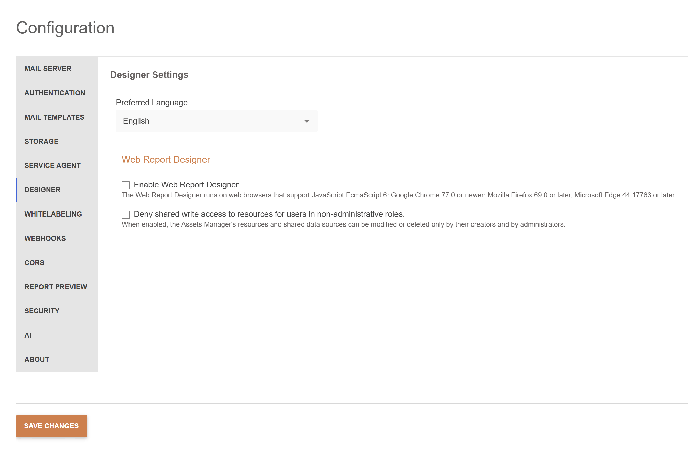
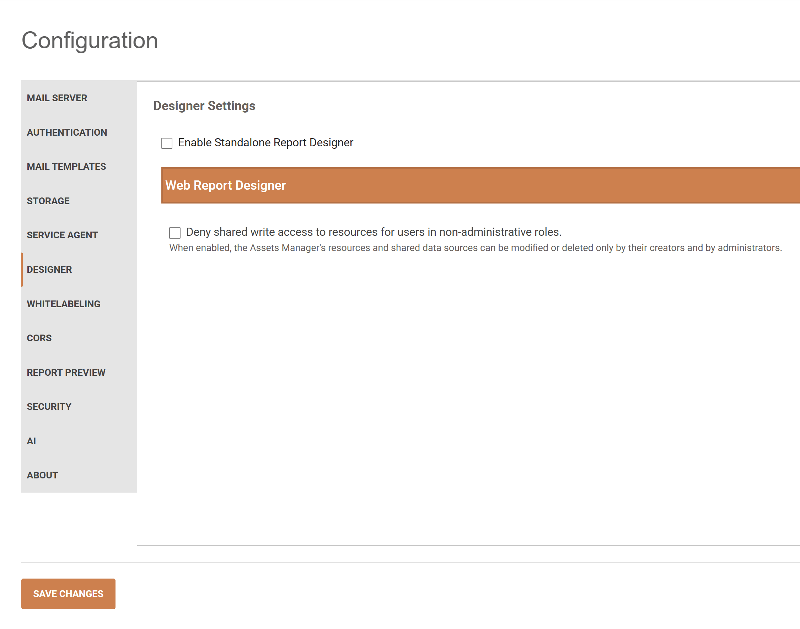

# Designer

The **Designer** tab of **Configuration** contains settings for the Standalone Report Designer and Web Report Designer.

## Standalone Report Designer

- **Preferred Language** - controls the language of the Standalone Report Designer. Represents a drop-down menu listing all languages available in the Report Server languages directory: `{TelerikReportServerInstallationDirectory}\Telerik.ReportServer.Web\Report Designer\Languages\{CultureName}`.

For more information, see the [Localization](slug:localization#localize-standalone-report-designer) article.

- **Enable Standalone Report Designer** - allows using Standalone Report Designer for creating and editing reports. Available in Report Server for .NET only.

## Web Report Designer

- **Enable Web Report Designer** allows using Web Report Designer for creating and editing reports. Available in Report Server for .NET Framework only.

- **Deny shared write access to resources for users in non-administrative roles** - restricts who can overwrite, rename, move, or delete shared assets. Applies to images, data files, stylesheets, and shared data sources in the **Assets Manager**.
When enabled, only users in administrative roles and the user who created the asset will be able to modify or delete it. When modifying or deleting a folder, the operation is successful if all the assets in the folder and its subfolders' operations satisfy the verification.

To enable the restriction:

1. Sign in as a System Administrator and open **Configuration** > **Designer**.
2. Expand **Web Report Designer**.
3. Select **Deny shared write access to resources for users in non-administrative roles.**
4. Select **Save Changes**.

Disabled by default for backward compatibility. Recommended state: **Enabled**.

Introduced with [Report Server 2026 Q4 (12.3.26.1111)](https://www.telerik.com/support/whats-new/report-server/release-history/progress-telerik-report-server-2026-q4-(12-3-26-1111)).
Available in both Report Server for .NET Framework and Report Server for .NET.

<TabStrip><TabStripTab title="Report Server for .NET Framework 4.6.2">
	
	</TabStripTab><TabStripTab title="Report Server for .NET 10">
	
</TabStripTab></TabStrip>

The following rules apply in addition to existing authentication and authorization:

| Setting and user | Write access |
| --- | --- |
| Disabled | This setting does not restrict changes to shared assets. |
| Enabled; user has the System Administrator role | The user can modify shared assets regardless of their creator. |
| Enabled; user created the asset | The user can modify the asset. |
| Enabled; asset has no recorded creator | The asset remains writable under the existing access rules. |
| Enabled; asset has another recorded creator, and user is not an administrator | The user cannot overwrite, rename, move, or delete the asset. |

New shared assets record the creator's user ID in `CreatedBy`, even when the restriction is disabled. Overwrite, rename, and move operations preserve the recorded creator.

Folders have no recorded creator. Before a folder is renamed, moved, or deleted, Report Server checks all contained files, including files in nested folders. The operation is denied if at least one contained file is not writable by the user.

The restriction applies to actions in the Report Server UI and corresponding Web Report Designer REST API operations. It does not add restrictions on reading assets or creating new assets. Reports remain subject to their existing [user permissions](slug:users#manage-permissions).

>note Existing assets without a recorded creator remain writable even when the setting is enabled. Enabling the setting does not assign creators retroactively.

## See Also

- [Web Report Designer](slug:web-report-designer)
- [Security Best Practices](slug:rs-security-best-practices)
- [Upgrading Report Server](slug:upgrade#shared-resource-write-access-after-an-upgrade)
