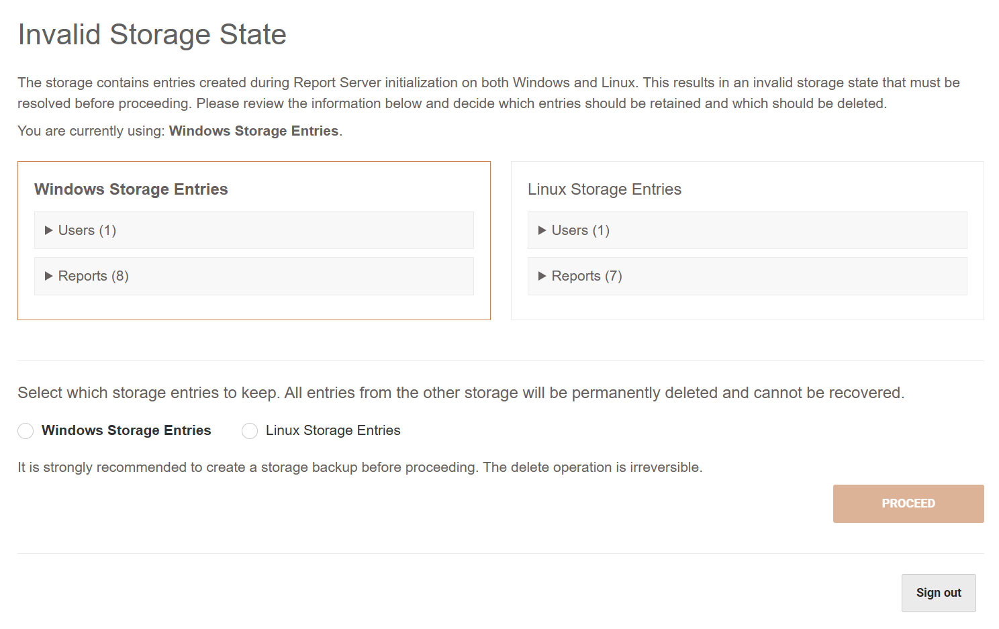
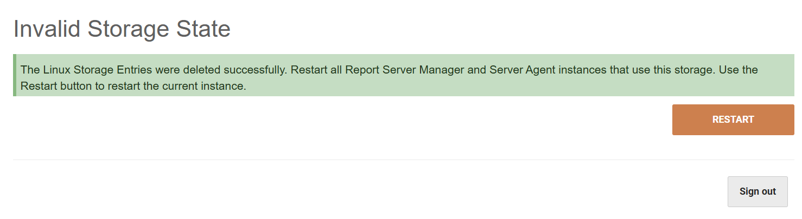
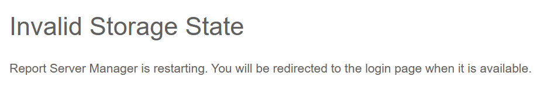

## Environment

<table>
    <tbody>
        <tr>
            <td>Product</td>
            <td>Progress® Telerik® Report Server for .NET</td>
        </tr>
    </tbody>
</table>

## Description

In Telerik Report Server for .NET (RS.NET), database storage keys use the path separator of the operating system where the entries are created. Windows uses a backslash (`\`), and Linux uses a forward slash (`/`).

As a result, an RS.NET instance on one operating system cannot reliably access database storage created on the other. If both systems initialize the same storage, the database can contain separate Windows and Linux entries. These entries can contain different users and reports.

The issue affects Microsoft SQL Server and Redis storage. File storage is not affected because it uses a directory hierarchy rather than a flattened key hierarchy.

For details, see the [database storage feature request](https://feedback.telerik.com/report-server/1720610-database-storage-used-by-report-server-for-net-is-not-os-agnostic).

## Solution

Upgrade all Report Server Manager and Server Agent instances that share the storage to [Report Server 2026 Q4 (12.3.26.1125)](<https://www.telerik.com/support/whats-new/report-server/release-history/progress-telerik-report-server-2026-q4-(12-3-26-1125)>) or later. The updated version detects the separator of the existing storage and uses it on both Windows and Linux. It does not need to rewrite the existing keys.

Before upgrading, back up the storage. When you move to another machine, also transfer the [encryption keys](slug:security#encryption) needed to access encrypted assets.

If the storage contains only one set of entries, the updated version detects and uses that set. If both Windows and Linux entries exist, an administrator must resolve the **Invalid Storage State** before users can access the Report Server Manager. Scheduled tasks and data alerts handled by the [Server Agent](slug:dotnet-server-agents) do not run while the storage is invalid.

## Resolving an Invalid Storage State

>warning The recovery process permanently deletes one set of entries. It does not merge the two sets. Back up the entire database before you upgrade or sign in to review the entries. The preview can upgrade storage data.

1. Stop all Report Server Manager and Server Agent instances that use the storage. Create and verify a database backup using the tools for your storage provider. For details, see [Manual Backup](slug:storage-backup#manual-backup).
1. Upgrade all instances to version 2026 Q4 (12.3.26.1125) or later. Start one Report Server Manager instance and sign in with an administrator account from the storage entries currently in use. Keep the other instances stopped until recovery is complete.
1. On the **Invalid Storage State** page, expand **Users** and **Reports** for both **Windows Storage Entries** and **Linux Storage Entries**. Review the entries and identify the set to retain. The lists show users and reports, not every stored asset.

   The following image shows the storage entries and the options for retaining one set:

   

1. Select the entries to keep, click **Proceed**, and confirm the deletion. RS.NET permanently deletes the other set of Report Server entries. If either preview cannot be read, resolve the error before you choose a set.

   The following image shows the confirmation after the Linux entries are deleted:

   

1. Click **Restart** to restart the current Report Server Manager instance. Start every other Report Server Manager and Server Agent instance that uses the storage.

   The following image shows the Report Server Manager restart page:

   

1. Sign in with an administrator account from the retained entries. Verify the reports, users, and other required assets. Confirm that the Server Agents connect and scheduled tasks and data alerts operate as expected.

If the restart does not complete, restart the Report Server Manager through its hosting environment. If the recovery fails or you cannot determine which entries to keep, contact [Telerik Support](https://www.telerik.com/account/support-center).

## See Also

- [Report Server Storage](slug:storage-settings)
- [Storage Backup](slug:storage-backup)
- [Report Server Security](slug:security)
- [Report Server for .NET Service Agents](slug:dotnet-server-agents)
