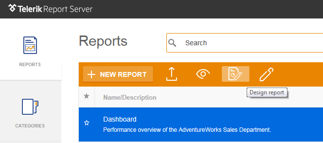

# Design Report

>important Use the Standalone Report Designer that matches your Report Server's framework before you edit a report. See [Server and Designer Compatibility](slug:report-designer#server-and-designer-compatibility).

Invoke the desktop [Report Designer](slug:report-designer) to modify the report definition.

Report Server for .NET Framework 4.6.2 starts the .NET Framework designer through [ClickOnce deployment](https://learn.microsoft.com/en-us/previous-versions/visualstudio/visual-studio-2015/deployment/clickonce-security-and-deployment). You can use a browser extension that adds ClickOnce support. If your browser does not support ClickOnce, use the download link from the edit action to download and start the designer manually.

For Report Server for .NET, use the server-provided download link to download and start `Telerik.ReportDesigner.Net.exe`. For details, see [Accessing the Standalone Report Designer](slug:report-designer#access).

## Telerik Report Server Learning Resources

* [Telerik Report Server Homepage](https://www.telerik.com/report-server)
* [Telerik Report Server Installation](slug:installation)
* [Telerik Report Server User Management](slug:user-management)
* [Connecting to Data with Telerik Report Server](slug:connecting-to-data)
* [Telerik Report Server License Agreement](https://www.telerik.com/purchase/license-agreement/report-server)

## See Also

* [Working with Report Server Reports](https://docs.telerik.com/reporting/standalone-report-designer-working-with-server-reports "Working with Report Server Reports")
