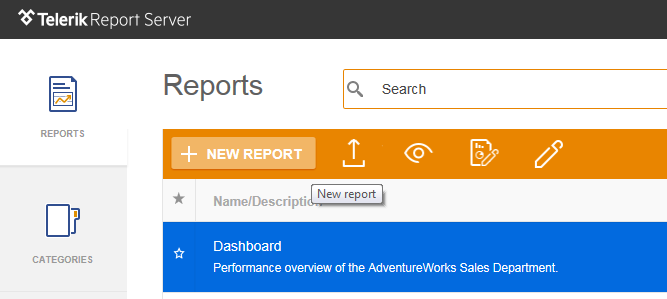

# New Report

>important Use the Standalone Report Designer that matches your Report Server's framework. A mixed .NET Framework and .NET configuration can fail when you create a blank report directly on the server. See [Server and Designer Compatibility]({slug:report-designer}#server-and-designer-compatibility).

Invoke the desktop [Report Designer]({slug:report-designer}) in order to create a new report on the server.

Report Server for .NET Framework 4.6.2 starts the .NET Framework designer through [ClickOnce deployment](https://learn.microsoft.com/en-us/previous-versions/visualstudio/visual-studio-2015/deployment/clickonce-security-and-deployment). You can use a browser extension that adds ClickOnce support. If your browser does not support ClickOnce, select **New Report** to display the designer download link. Use the link to download and start the designer manually.

For ClickOnce deployment issues, clear the online application cache with [Mage.exe (Manifest Generation and Editing Tool)](https://learn.microsoft.com/en-us/dotnet/framework/tools/mage-exe-manifest-generation-and-editing-tool) or `rundll32 dfshim CleanOnlineAppCache`.

For Report Server for .NET, use the server-provided download link to download and start `Telerik.ReportDesigner.Net.exe`. For details, see [Accessing the Standalone Report Designer]({slug:report-designer}#access).

> If you add a [ReportBook](https://docs.telerik.com/reporting/designing-reports/report-book/overview) to the Report Server or use [SubReport item](https://docs.telerik.com/reporting/report-items/subreport) or [NavigateToReport action](https://docs.telerik.com/reporting/interactivity/actions/drillthrough-report-action) in your reports stored in the Report Server, ensure the [ReportSources](https://docs.telerik.com/reporting/embedding-reports/report-sources) are properly referenced, with their [CategoryName]/[ReportName] as explained in the article [Working with Report Server Reports](https://docs.telerik.com/reporting/standalone-report-designer-working-with-server-reports "Working with Report Server Reports").

## Telerik Report Server Learning Resources

* [Telerik Report Server Homepage](https://www.telerik.com/report-server)
* [Telerik Report Server Installation]({slug:installation})
* [Telerik Report Server User Management]({slug:user-management})
* [Connecting to Data with Telerik Report Server]({slug:connecting-to-data})
* [Telerik Report Server License Agreement](https://www.telerik.com/purchase/license-agreement/report-server)

## See Also

* [Working with Report Server Reports](https://docs.telerik.com/reporting/standalone-report-designer-working-with-server-reports "Working with Report Server Reports")
