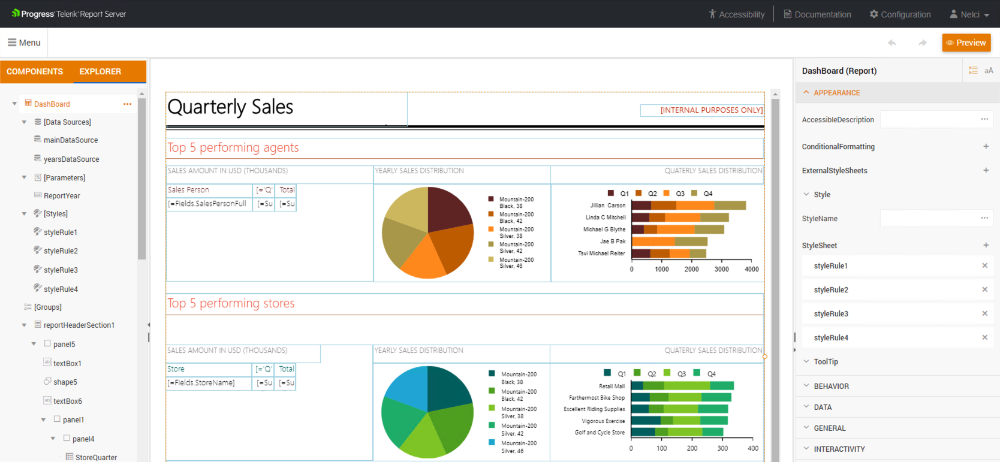
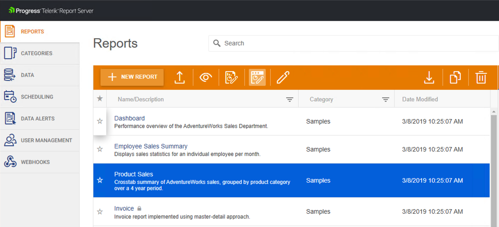

# Web Report Designer

Since R2 2019, we have offered a web-based report designer that allows creating and designing reports in the Report Server.
Further information about this control can be found in [Telerik Web Report Designer](https://docs.telerik.com/reporting/designing-reports/report-designer-tools/web-report-designer/overview) article.

### Access

In Report Server for .NET Framework, open **Configuration** > **Designer** and expand **Web Report Designer**. Select **Enable Web Report Designer**, then select **Save Changes**.

Report Server for .NET does not expose this checkbox. Its **Enable Standalone Report Designer** setting controls the desktop designer, not the web designer. For the settings available in each variant, see [Designer](#web-report-designer).

Use the Web Report Designer icon in the reports view to open the designer:

### Data Connectivity

Report Server supports [WebService](https://docs.telerik.com/reporting/webservicedatasource-component), [JSON](https://docs.telerik.com/reporting/jsondatasource-component), [SQL](https://docs.telerik.com/reporting/sqldatasource), [Business Objects](https://docs.telerik.com/reporting/designing-reports/connecting-to-data/data-source-components/objectdatasource-component/overview), [Entity Framework Core](https://www.telerik.com/products/reporting/documentation/designing-reports/connecting-to-data/data-source-components/entitycoredatasource-component/overview) (only Report Server for .NET) and inline [CSV](https://docs.telerik.com/reporting/csvdatasource-component) data sources.

### Shared Data Source

In the Web Report Designer the report authors can predefine Data Source definitions called [Shared Data Source](https://docs.telerik.com/reporting/designing-reports/connecting-to-data/data-source-components/shareddatasource-component). Each available Shared Data Source can be then utilized as a resource by the report authors while building reports to connect and return tabular data sets. This way the report authors can create multiple reports conveying different messages using the same Shared Data Source definition. Using this feature, two professionals can collaborate to produce the reports: A data expert can define the shared data sources, and a visualization specialist can focus on the data presentation creating reports on top of the available data sources.

Shared data source files (`.sdsx`) are shared assets, separate from the report permissions described in [User Permissions](). They are subject to the [shared-resource write restriction](#web-report-designer) described below.

### Report Resources

The Web Report Designer lets you upload and manage shared resources such as images, styles, and data files on the server. These resources can be reused across multiple reports, helping maintain visual consistency while reducing duplication. Shared JSON and CSV data files can also be updated in one place while referenced by multiple reports. Resource management is available through the `Assets Manager` For more details, see the [Report shared resources](https://docs.telerik.com/reporting/designing-reports/report-designer-tools/web-report-designer/tools/shared-resources) article.

Note that in the context of the Report Server, the reports are organized into one-level directories representing the report categories on the Report Server.

Starting with [Report Server 2026 Q4 (12.3.26.1110)](https://www.telerik.com/support/whats-new/report-server/release-history/progress-telerik-report-server-2026-q4-(12-3-26-1110)), administrators can enable **Deny shared write access to resources for users in non-administrative roles**. This setting is disabled by default and applies to both Report Server variants.

When enabled, assets that have an recorded creator can be overwritten, renamed, moved, or deleted only by their creator or a System Administrator. Existing assets without an recorded creator remain writable according to the standard Report Server access rules. Renaming, moving, or deleting a folder is permitted only when the user has write access to all files in the folder and its subfolders.

The setting does not add restrictions on reading shared assets or creating new assets. Report permissions remain unchanged. For configuration steps and the complete rules, see [Designer settings](#web-report-designer).

### Browsers Support

The Web Report Designer can run on web browsers that support `JavaScript ECMAScript 6`: Google Chrome 77.0 or newer; Mozilla Firefox 69.0 or later, Microsoft Edge 44.17763 or later.

## Telerik Report Server Learning Resources

- [Telerik Report Server Homepage](https://www.telerik.com/report-server)
- [Telerik Report Server Installation]()
- [Telerik Report Server User Management]()
- [Connecting to Data with Telerik Report Server]()
- [Telerik Report Server License Agreement](https://www.telerik.com/purchase/license-agreement/report-server)

## See Also

- [Telerik Web Report Designer](https://docs.telerik.com/reporting/designing-reports/report-designer-tools/web-report-designer/overview "Web Report Designer Overview")
- [Table/Crosstab Wizard in Web Report Designer](https://docs.telerik.com/reporting/designing-reports/report-designer-tools/web-report-designer/tools/table-crosstab-wizard "Table/Crosstab Wizard in Web Report Designer")
